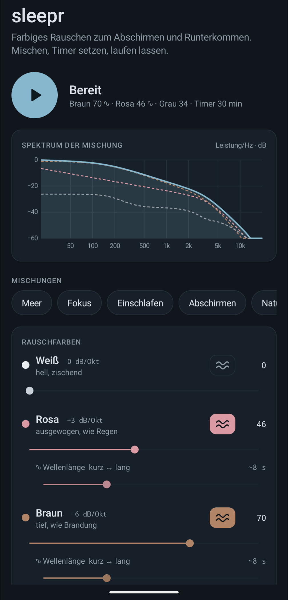

# sleepr

Rauschgenerator für Android: weißes, rosa, braunes, graues und grünes Rauschen live erzeugt und frei mischbar. Gedacht zum Abschirmen von Störgeräuschen, Konzentrieren und Einschlafen.

<p align="center"></p>

## Funktionen
- 5 Rauschfarben, in Echtzeit am Gerät berechnet (keine Audiodateien, keine Schleifen)
- Wellen-Modus je Farbe: zufällige Meereswellen mit einstellbarer Wellenlänge (3–20 s)
- Presets: Meer, Fokus, Einschlafen, Abschirmen, Natur, Klassisch weiß
- Höhenregler (Tiefpass 400 Hz – 20 kHz) und Spektrumanzeige der Mischung
- Timer (15–90 min) mit sanftem Ausblenden
- Läuft als Vordergrunddienst weiter, auch bei gesperrtem Bildschirm; Stopp über Benachrichtigung/Sperrbildschirm
- Keine Abhängigkeiten außer Android-Plattform und Kotlin-Stdlib, keine Berechtigungen außer Benachrichtigung

## Installieren
Die aktuelle APK liegt unter [Releases → latest](../../releases/tag/latest). Am Handy herunterladen, öffnen und „Installation aus unbekannten Quellen“ für den Browser erlauben.

## Selbst bauen
```sh
gradle assembleRelease   # Gradle ≥ 8.7, JDK 17, Android SDK (compileSdk 34)
```
APK: `app/build/outputs/apk/release/app-release.apk`

`app/sleepr.keystore` ist ein bewusst öffentlicher Schlüssel, damit Builds sich gegenseitig updaten können. Für eine Play-Store-Veröffentlichung einen eigenen, geheimen Schlüssel verwenden.

## Lizenz
GPLv3
